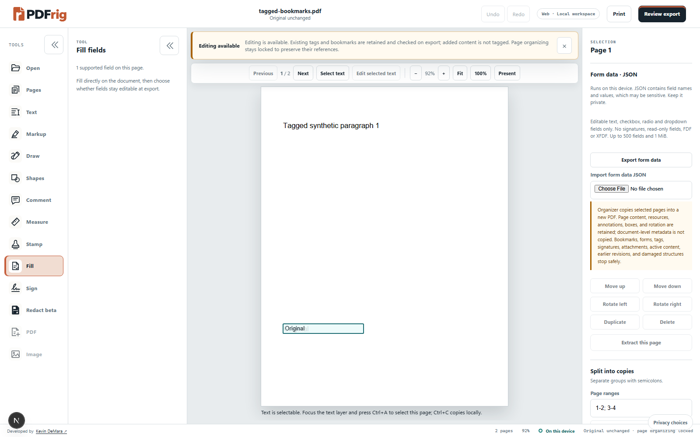
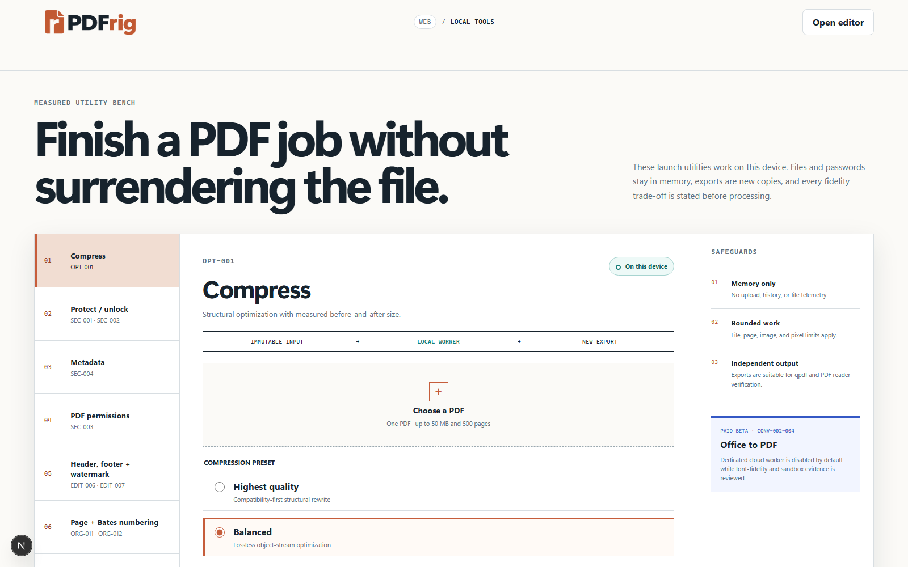

# PDFrig — Build better PDFs

A local-first PDF workspace for viewing, organizing, annotating, filling forms
and creating new copies of your documents. Shared web and Windows editor code;
no account is needed to try the local browser tools.

**Status: development preview, not a public release.** Bounded existing-text editing
and local OCR are connected to the editor with actual-PDF output review and undo.
Do not mistake **Add text** overlays for **Edit existing text**. Not every font or
PDF is editable. There is no supported public Windows installer yet.

[Quick start](#quick-start) · [Windows](#windows) ·
[Self-hosting](#self-hosting) · [Release checklist](#roadmap-and-launch) ·
[Detailed feature status](docs/product-scope.json)

## See the workspace



_Real local development screenshot using our purpose-created CC0 PDF corpus.
Optional QA flags are enabled; gated tools are not approved for release. Notices
can be dismissed/restored; required warnings remain in export review._



_Local tools create new copies. Screenshots contain no customer documents._

## What works today

These are bounded, fixture-tested capabilities—not a claim that every PDF is supported.

| Job                | Current support                                                                                                    |
| ------------------ | ------------------------------------------------------------------------------------------------------------------ |
| Read               | Render, search, select/copy searchable text, measured full-page fit, outline navigation and virtualized thumbnails |
| Edit original text | Supported uniform paragraphs wrap at the original font size; actual-PDF review and undo/redo                       |
| OCR a scan         | Local English/French recognition of the current unrotated page; invisible search/copy text, unchanged visible scan |
| Organize           | Merge, insert, reorder, rotate, duplicate, delete, split and extract compatible pages, with undo/redo              |
| Add marks          | Text boxes/callouts, markup, comments, live freehand drawing, shapes and stamps; drag/resize added items           |
| Fill & sign        | Supported AcroForm fields; typed script-font, drawn or uploaded **visual** signatures                              |
| Create & convert   | Blank PDFs, supported images/text to PDF, selected PDF pages to PNG/JPEG                                           |
| Refine             | Lossless compression, metadata tools, page/Bates numbering, headers/footers, crop and bounded resize               |
| Protect            | Bounded password/encryption and permission tools, with authority checks and explicit limitations                   |

Existing tags/bookmarks can be retained on the supported unchanged-page annotation
path and are checked on export. Page organizing has stricter support limits.
Every operation can refuse a document it cannot safely preserve.

### Important limitations

- **Original text:** use **Select text**, highlight words on the page, then choose
  **Edit selected text**. Alternatively choose **Text → Edit existing text** and
  pick a supported logical line (adjacent letter fragments are grouped together).
  A selection is matched by text and page location; ambiguous/unmatched selections
  are refused rather than silently choosing another occurrence. Repeated words
  within the same logical line currently require a unique phrase or explicit line choice.
  The dialog separates the exact selected text from its full source-line context.
  Enter the replacement and click **Build actual PDF preview**. Review and apply
  stay unavailable until a preview succeeds; after reviewing it, check the review
  box and apply. Changing the replacement or layout invalidates the previous preview/review.
  **Text layout** defaults to **Wrap paragraph naturally**. Longer edits rewrap the
  containing uniform paragraph at its original font size and character proportions;
  no squeezing or shrinking. Selections can span lines within that paragraph.
  Adjust **Paragraph width/height (pt)** within the displayed safe limits. Explicit
  line breaks are supported. Neighboring blocks stay in place: insufficient vertical
  space produces an overflow message, not overlapping text or automatic new pages.
  On pages with graphics or annotations, expansion is restricted to the original
  paragraph area; linked text is not reflowed. Mixed-style paragraphs, complex
  transforms and automatic cross-page flow are not supported. Choose **Keep selection
  on one line (must fit)** for strict natural-width, single-line replacement instead.
  Clipping around a logo does not lock unrelated text: clipping and unsupported
  graphics states are scoped to the affected text, with a specific explanation when refused.
  The original
  font must have an unambiguous supported encoding; printable ASCII only, using
  existing glyphs. Current font support is non-symbolic Base-14 Type1 fonts or
  Identity-H CID fonts with one-to-one supported ToUnicode mappings; unknown simple
  embedded fonts remain read-only. No
  font substitution, XObject editing or covering rectangle. Unsupported text stays
  read-only; uniquely owned accessibility text is repaired, not stripped.
- **Scans:** choose **Text → OCR this page**, select English/French and review
  recognized words and the actual output before applying. OCR runs on this device,
  not automatically on open. Scanned words are **not visibly editable**: the scan
  image remains unchanged, as requested. OCR adds invisible, untagged search/copy
  text. Rotated pages, already-searchable pages and unsupported OCR glyphs refuse
  the operation. OCR can misread words; recognition accuracy is not guaranteed.
- These actions retain up to eight in-session source copies for undo; reopen a
  saved copy to begin another session. Cancel terminates OCR workers; recognition
  has a three-minute deadline. Large/complex pages may exceed the 20-megapixel limit.
  OCR receives only a bounded, generated P6 RGB raster, not user image headers or
  compressed image streams. Older codecs remain compiled into the pinned runtime;
  this mitigation is not native security clearance for public distribution.
  The worker boundary independently rejects noncanonical/shared/truncated P6 data
  before initialization and rechecks it immediately before native recognition.
  A fixed ASCII header area keeps pixels out of the wrapper's first-500-byte
  EXIF probe, preventing pixel bytes from being treated as orientation metadata.
- **Signatures:** visual signatures are not certificate-backed signatures or proof
  of identity. Editing may invalidate existing digital signatures.
- **Redaction:** the separately gated raster-removal beta is not a black-box overlay;
  it changes document semantics and is not approved for public use.
- Forms, tags, attachments, encryption, active content, saved revisions, malformed
  structures and unusual fonts can constrain operations. Read warnings rather
  than assuming that a file which renders is safe to rewrite.
- Exported new content is not automatically tagged. No PDF/UA, PDF/A, legal,
  universal compatibility or perfect-OCR claim is made.

See the [feature catalogue](docs/product-scope.json) for exact IDs, verification
states and remaining work.

## Quick start

For the **browser app only**, install Git, Node.js **24.19.0** and pnpm **11.22.0**.
Rust, C++ tools, Docker and PDF verification tools are not needed just to try it.
Repository access is required while it remains private.

```powershell
git clone https://github.com/kevindemara/PDFrig.git
cd PDFrig
npm install --global pnpm@11.22.0
pnpm install --frozen-lockfile
pnpm web:dev
```

Open [the workspace](http://127.0.0.1:3000/workspace) or
[local utilities](http://127.0.0.1:3000/tools). Keep the terminal open.
Press Ctrl+C there to stop the server.

The first build downloads pinned, SHA-256-verified English/French OCR models from
the upstream public repository. Worker/core assets come from locked npm packages.
After preparation, OCR uses only local `/ocr/` assets—no runtime CDN or document
upload. The Windows bundle includes these assets for offline use. Asset preparation
fails if required versions or hashes differ; do not disable its checks.

No credentials or paid services are needed for this loopback development preview.
Do not expose the development server to the internet. The repository retains its
internal PDFMason package/directory names; PDFrig is the display brand.

1. Open a PDF or use a [synthetic fixture](packages/test-corpus/fixtures/manifest.json).
2. Use **Select text** for searchable PDFs, or choose an annotation/form tool.
3. Review the preservation notice. Dismissing it changes presentation, not permissions.
4. Choose **Review export**, check warnings and save a new copy.
5. Open that copy in another PDF reader and inspect the affected pages.

The source stays unchanged. Unsaved editor work is session-only; keep the tab open
until you save. Typical editor bounds are 50 MB per input, 500 pages and 1,000
added marks; individual operations have additional limits.

### Configuration and troubleshooting

Environment names and safe defaults are in [.env.example](.env.example). If you
customize values, keep credentials in ignored local environment files. Never
commit them. To choose another loopback port in PowerShell:

```powershell
pnpm build:packages
$env:NEXT_PUBLIC_APP_URL='http://127.0.0.1:3101'
$env:PDFMASON_ALLOWED_ORIGINS='http://127.0.0.1:3101'
pnpm --filter @pdfmason/web dev --port 3101
```

Stop with Ctrl+C; do not stop unrelated processes to free a port. If installation
fails, check the pinned versions and lockfile rather than upgrading dependencies
indiscriminately. A scan with no selectable text needs **Text → OCR this page**.
Use **Select text** to copy searchable text; use **Edit existing text** to change
supported original runs. **Add text** creates an overlay. If an export refuses a risky structure, keep the original and
inspect the warning; do not bypass preservation checks.

## Privacy and hosting

Local PDF operations run in the browser or desktop session; they do not upload
document contents. Optional account/cloud demos are clearly labeled and are not
real OCR/conversion services. Analytics consent is separate from PDF processing.

Self-hosting a production service is **not yet a credential-free one-command
deployment**. The existing production configuration still expects the legacy
Supabase/R2/Stripe stack. A reviewed local/self-hosted distribution mode must be
completed before promising a standalone public package.

### Self-hosting

Do not use fake-provider development mode as a public service. Before exposing
any service, complete the standalone versus managed-service configuration decision
and test the selected mode. The existing production mode requires real Supabase,
private R2, Stripe, origin/region/retention and price configuration; startup checks
must not be disabled to make a demo deployable.

For a shared service, use separate staging resources, HTTPS, exact origins,
private storage, opaque object keys, short-lived grants, RLS and negative
cross-user tests. Never expose database/worker control ports or put trusted keys
in client bundles. Run native OCR/Office only in bounded, non-root, isolated
workers with reviewed images and clear consent before upload. Review CSP/CSRF,
rate/body limits, cancellation, deletion reconciliation, secrets, image licensing
and rollback before inviting users. Operational controls and remaining staging
exercises are in the [operational handbook](docs/operations/handbook.txt).

Local source testing requires no paid service. Hardware/electricity/internet still
apply; hosting, domains and optional providers are not guaranteed free.

## Windows

The shared editor runs in a Tauri 2 Windows shell. Building it requires the
separate free Rust/C++/Windows SDK toolchain. Internal unsigned NSIS build
orchestration exists for controlled testing, but the current native build is
blocked by Windows Application Control. **No current-source installer has been
produced or install-tested. Windows compliance is not certified.** Old internal
artifacts do not verify today's source. Clean-machine installation, upgrade/uninstall,
notices and release review remain open; see the [Windows QA record](docs/operations/windows-installer-qa.json).

### Run from source

Install Rust **1.98.0**, the free Microsoft C++ Build Tools workload and Windows
SDK, plus WebView2. See the [official Tauri Windows prerequisites](https://v2.tauri.app/start/prerequisites/#windows).
First complete the Git/Node.js/pnpm setup in [Quick start](#quick-start), clone the
repository and open PowerShell in its root. Confirm `node --version`,
`pnpm --version`, `rustc --version` and `cargo --version` match the pinned tools.
Use the `x86_64-pc-windows-msvc` Rust host, not the GNU host. In the Microsoft
installer, select **Desktop development with C++**, including MSVC and a Windows
SDK; install only tools whose terms you are eligible to use. Then run:

```powershell
pnpm install --frozen-lockfile
pnpm desktop:dev
```

This opens the native development window; it does not install PDFrig. Keep the
terminal open, save/export work before closing, and press Ctrl+C to stop it.
If Windows blocks a build helper, stop: do not disable Application Control,
rename/move executables, change policies or substitute toolchains to evade it.
Use the browser preview until an approved developer/reference host is available.

Native save creates a new file and refuses overwriting an existing file. The
shell shares the same feature limits and local OCR assets. Native installed-app
offline OCR still requires reference-machine verification before release.

### What GitHub users will download

**Code → Download ZIP is source code, not an installed Windows app.** It requires
the development tools and commands above. Once a reviewed installer is published,
ordinary users will instead open this repository's **Releases**, download the
Windows x64 `.exe` installer and its checksum, and run the installer. They will
not need Node.js, pnpm, Rust, C++ Build Tools, Docker or a server. Releases remain
access-controlled while the repository is private; no installer is published yet.

The planned NSIS installer installs for the current Windows user and creates a
Start-menu shortcut. It installs WebView2 if missing (that bootstrap can need an
internet connection); afterwards bundled local editing/OCR needs no account or
paid service. Save/export work before installing a newer version, close PDFrig,
then run the new approved installer. Uninstall through Windows **Installed apps**.
Your PDFs and exported files must remain untouched. These install/upgrade/uninstall
claims must be confirmed on clean reference machines before publishing artifacts.

With the no-cost unsigned route, Windows may show an unknown-publisher/SmartScreen
warning; another extension does not remove trust checks. A SHA-256 checksum checks
download integrity, not publisher identity. Never disable Windows protections or
circumvent organizational policy. If installation is blocked, use source/browser
testing instead. No paid code-signing certificate is required to build an internal
installer, and none has been purchased.

### Internal installer testing

Audit notice texts without starting a native build, signer or installer:

```powershell
pnpm desktop:notices
pnpm desktop:notices --require-complete
```

This needs the pinned Rust toolchain and already-cached locked Cargo/npm dependencies.
It does not download or compile anything. If Cargo is not on PATH, set
`PDFRIG_CARGO_PATH` to its approved installed executable; do not use another toolchain
to evade a security-policy block. Reports stay in an ignored, fresh `tmp/desktop-notices-*`
directory. The strict form exits unsuccessfully while any text gaps remain. As of
October 19, 2026, 28 of the conservative 571 declared build-input records still lack
retained notice text (down from 51); this is not a final-artifact SBOM or legal clearance.
Twenty-two exact-version supplements are checked against pinned commits, original
manifests, crate archive hashes and retained-text hashes. Where an upstream crate
offers alternative licenses, the retained branch is recorded, not applied to other
components. A licensing explanation or SPDX declaration alone is not a replacement
for missing full text. The [remaining-gap review](docs/dependencies/desktop-notice-review.json)
records the unresolved groups and next evidence needed. Do not mark an optional
dependency cleared merely because a Windows build may omit it; establish the final
artifact's contents separately. The internal installer uses this same collector.

The audit also emits `windows-msvc-scope.json`: locked target metadata currently
narrows the unresolved prospective Windows inputs to four npm packages; the other
24 Rust gaps are retained in the full audit. This is not evidence that any package
is absent from the installed artifact. `selectors` retains its explicit MPL-2.0
notice, full steward terms and exact unmodified-source location; project restrictions
cannot override that component's source rights. `r-efi` retains its original full
AUTHORS text with the offered MIT branch recorded. No author notices are invented.

The [Windows package review](docs/dependencies/windows-npm-notice-review.json)
binds installed package contents to exact integrity-checked npm archives. Run
`pnpm license:notices:windows` on the Windows x64 checkout for an offline comparison,
or add `--registry` to recheck published metadata and archives (network required).
It never executes package scripts or loads the native addon. These checks verify
provenance, **not complete notices**: missing project terms, derivative code,
bundled Skia/ICU/encoder attribution remain explicit blockers. Known Brotli decoder
headers and full explicitly adopted Apache terms are now retained, but are marked
partial and do not clear the other package terms. Fontkit's inherited Base64
decoder copyright and full MIT terms are also retained with
[source evidence](docs/dependencies/fontkit-derived-notice.json), but do not clear
Fontkit's missing project-level terms. Missing-notice requests already
exist upstream; follow-up drafts and the integration's posting restriction are
recorded in the review.

One gap was removed by eliminating an unused dependency, not by changing its
license: Tesseract 7 already uses built-in `fetch` on supported Node >=22.13.
A version-scoped pnpm override removes its legacy `node-fetch` fallback and the
exclusive `whatwg-url`/`tr46`/`webidl-conversions` subtree. Node image and language
model fetches pass English/French local-HTTP tests without patching upstream code.
`node scripts/verify-ocr-node-fetch.mjs` repeats that synthetic check after OCR asset
preparation. Old runtimes without platform `fetch` are not supported.

Use only a disposable Windows x64 VM/reference machine. In a clean test checkout,
`pnpm desktop:internal-build` prepares a current-user NSIS alpha installer,
ephemeral updater test key, checksum and signature evidence in an ignored build
directory. The helper refuses reuse/replacement of signing material; do not delete
keys or weaken its guards to rerun it. Never commit artifacts or private keys.

The artifact is **not Authenticode-signed or approved for public distribution**.
An updater signature is not a Windows-verified publisher identity. Do not disable
Windows protections or work around device policy. Source/browser testing remains
available if installation is blocked.

For an approved internal artifact, compare `Get-FileHash -Algorithm SHA256` with
its exact build manifest; matching bytes do not establish trust. Verify updater
signatures and tamper rejection with the desktop offline-verification harness.
Follow installer prompts only in the disposable machine. Record version/location,
Start-menu and shortcut target/name, taskbar and high-DPI icons, offline launch,
synthetic PDF open/save/cancel and any association changes. Do not silently replace
a user's default PDF app. Independently open the exported copy and verify the
source stayed unchanged.

### Upgrade and uninstall

There is no public update channel. Do not invent URLs, reuse alpha keys for a
release or turn off signature verification. Release testing must cover installing
over an existing version, ownership/data preservation and tampered-update refusal.
For source updates: save/export work, stop the app, update without discarding local
changes, run `pnpm install --frozen-lockfile`, then restart `pnpm desktop:dev`.

For an installed alpha, save/export and quit, then use Windows installed-app
settings to run its registered uninstaller. Sign out and clear optional recent
files first if you want to remove account caches/path history. Uninstall must not
delete PDFs or exports. Verify remaining per-user configuration and restore the
previous default PDF app if necessary; complete data erasure is not yet certified.
Deleting a source checkout is not an uninstaller and must not remove documents.

No installer binaries, signing keys, customer documents or build caches belong in
Git. Do not disable Windows protections to install an unknown build.

## Development and verification

```powershell
pnpm check
pnpm test:browser
```

`pnpm check` runs formatting, lint, strict types, unit/component tests, native
surface restrictions, license/secret checks and builds. Browser verification also
needs Playwright Chromium, qpdf **12.4.0**, Poppler (`pdftoppm`, `pdftotext`) and
Python with `pypdf` **6.16.1** / `cryptography` **50.0.0**. Browser original-text
render verification also uses Pillow **12.3.0**. Install Chromium with
`pnpm exec playwright install chromium`. Configure `PDFMASON_QPDF_PATH`,
`PDFMASON_PYTHON_PATH` and put Poppler tools on PATH; individual verification
harnesses also support `PDFMASON_PDFTOPPM_PATH`. The bounded prerequisite probe never installs tools.
Browser tests own port 3100 and an isolated cache; choose another port with
`PDFMASON_BROWSER_TEST_PORT` (1024–65535) if needed. Never point QA at a user tab.
Docker is required for
`pnpm test:ocr-worker` and `pnpm test:office-worker`; these verify isolated workers,
not approval of the native image for public availability. Editor OCR tests use
the separate local WASM path and do not require Docker.

### Experimental minimal OCR build (maintainers only)

The existing app still uses the pinned upstream OCR runtime. A separate
[research candidate](docs/dependencies/ocr-minimal-candidate.json) builds the
baseline LSTM engine with Leptonica 1.87.0 and without the optional compressed-image
codec libraries/OpenLibm. It is **not adopted or security-cleared**. Synthetic
English/French recognition passed. Private Leptonica layout access was removed:
17 scalar bindings use public getters, and 25 raw/ownership-ambiguous calls now
trap. A synthetic native check exercises owned allocation/read/free cycles;
patch-drift and forbidden-call tests also pass. The candidate backports the upstream
RecodeNode assignment fix; a failing original-source control and 1,000 targeted
ownership cycles pass AddressSanitizer/UndefinedBehaviorSanitizer checks in the
pinned Linux container. These use the actual extracted struct, not the whole engine.
The research worker entry point also checks the exact canonical P6 header, dimensions,
depth and RGB body length natively, before image allocation/decoding. It refuses alternate
formats, metadata, non-default orientation/rotation and inputs over 20 million pixels.
The same validated open stream goes directly to the PNM reader, not general image
format dispatch. Targeted preflight sanitizer mutation tests and malformed-input
checks through the actual WASM API are separate from full parser/model fuzz clearance.
Six unused alternate image-ingestion bindings (raw buffers, external Pix pointers
and page/file processing) abort before dereferencing arguments, so those exports
cannot bypass the guarded worker image entry. This does not clear all remaining
pointer, renderer or model APIs and is not a general-purpose Tesseract replacement.
Old Tesseract code, the remaining API/parser surface, broader export/accuracy/platform
tests and final notice/security review remain gates. The candidate record distinguishes
each artifact's reproducibility evidence. No candidate binaries are stored in Git.

On an approved Docker host with sufficient disk space, maintainers can explicitly run:

```powershell
node scripts/prepare-ocr-minimal.mjs
```

The helper downloads hash-checked source archives into a fresh ignored
`tmp/ocr-minimal-*` folder, then builds in a digest-pinned, unprivileged Linux
container with no network, a read-only root and bounded CPU/memory/processes.
It does not mount the repository, credentials or documents, install application
assets, compile Windows helpers, change policy or work around Application Control.
It does not pull the toolchain image automatically; obtain the exact image in the
candidate record through your normal approved Docker setup first. The build can
use several GB of local disk and runs with a 30-minute deadline.

After `pnpm build:packages`, use the generated folder printed by the helper:

```powershell
node scripts/verify-ocr-minimal.mjs tmp/ocr-minimal-REPLACE/tesseract-core-lstm.wasm.cjs
```

This checks the research artifact's public API, native image refusals and forbidden-call traps, then uses
an isolated loopback server/headless Chromium and synthetic canvas text;
it never changes a user tab or substitutes the candidate into the local app.
It is a baseline-only smoke, not verification of the SIMD variants or permission
to ship the candidate. Do not copy a candidate over the pinned application assets.

Use synthetic/licensed fixtures only. Never put PDFs, extracted text, filenames,
passwords or signature data into logs, issue attachments or analytics. Report
sensitive security issues privately rather than publishing document samples.
The PDF/image/text corpus is purpose-created CC0 with hashes and sensitivity
records in its fixture manifests; Office sandbox samples have a separate
[synthetic provenance manifest](apps/worker/test-fixtures/manifest.json).

Additional environment-dependent checks include `pnpm test:pdf-corpus`,
`pnpm test:pdf-utilities`, `pnpm test:pdf-decorations`, `pnpm test:pdf-permissions`,
`pnpm test:local-text` (original font/geometry, following-text advance and pixels),
`pnpm security:audit` and native Rust checks. Database tests require local Docker/
Supabase: `pnpm db:start`, `pnpm db:test`, `pnpm test:db-concurrency`,
`pnpm db:advisors`, then `pnpm db:stop`. Use isolated synthetic accounts only.

## Roadmap and launch

Implemented: bounded original-operator editing through the existing MIT PDF
library, repaired accessibility text, local scan-preserving OCR, actual-PDF review,
undo/redo and independent export checks. Next: broaden font/language/layout/tag
coverage, verify native installed-app OCR and complete standalone distribution.

Also required: the chosen source license, complete third-party notices/SBOM,
secure standalone distribution, Windows reference-machine checks, broader
accessibility/security testing and reproducible release artifacts. The
following launch blockers must be resolved with actual evidence, not merely flags:

- Broaden original-text Unicode/font/reflow coverage and manual accessibility
  verification. The [assessment](docs/dependencies/source-text-engine-review.json)
  records the selected existing-library alternative; unbound PDFium remains rejected.
- Broaden OCR alignment/recognition benchmarks and refresh or independently clear
  the exact native WASM dependency graph. [OCR review](docs/dependencies/ocr-engine-review.json)
  records retained notices, source binding, known older native components and
  bounded input mitigations; it is not blanket legal/security certification.
- Implement the chosen free local/self-hosted distribution mode without exposing
  development fakes or bypassing trusted-service authorization.
- Approve the project's source-available legal terms and third-party obligations;
  generate complete final SBOMs/notices and scan exact dependencies/worker images.
- Decide the no-cost Windows distribution/signing policy; complete clean-machine
  install/upgrade/uninstall, shortcuts/icons and offline/update-tamper testing.
- Complete manual assistive-technology/high-DPI testing, independent security
  review, production-like smoke/rollback/deletion exercises and brand clearance.

`pnpm beta:release-gate` intentionally requires separately reviewed public
approvals and measured economics. Passing local tests alone does not approve
public distribution or production deployment.

The monorepo has `apps/web`, `apps/desktop`, `apps/worker` and shared `packages/*`.
The [feature catalogue](docs/product-scope.json) retains stable IDs, support
contracts, states and excluded specialist scope. Keep IDs and update executable
tests/catalogue/README with behavior changes; do not silently expand exclusions.

### Contributor safety rules

Protect documents before convenience. Keep originals immutable and verify changed
outputs structurally, semantically and with independent renders. Never silently
drop tags/forms/bookmarks, rasterize, flatten or downgrade encryption. Fail safely
with structured warnings when preservation cannot be established. Visual marks
are not redaction or certificate-backed signatures. Critical content exposure,
source loss, recoverable redaction or signing compromise stops release.

Use strict TypeScript, shared editor behavior, typed adapters and bounded schema
validation at every untrusted boundary. Honor server-side tenant isolation and
entitlements; never grant access from a redirect or caller-supplied identity.
Do not log document bytes, text, filenames, passwords, signatures, object keys,
tokens or signed URLs. Maintain local/cloud disclosure, keyboard accessibility,
undo/redo and deletion/cancellation controls. No production documents as fixtures.

Dependencies require exact provenance, maintenance/security, license/transitive
and platform/bundle review. Deny AGPL, SSPL, unknown and incompatible licenses by
default; native GPL/LGPL distribution requires an explicit legal compliance plan.
Retain all required notices. Never commit environment files, keys, installers,
research downloads, toolchains or build/test caches. Native operations belong in
isolated workers, not web requests. Existing migrations are append-only.

Run formatting/lint/types, automated positive/negative tests and relevant
integration/fidelity checks; reject retry-dependent browser success. Keep changes
reviewable and preserve unrelated work. This version of Next.js has versioned
guides in `apps/web/node_modules/next/dist/docs/`; consult them before framework
changes. Historical planning/checkpoint files are intentionally not in the
publishable tree.

Preserve the approved PDFrig logo/mark and original Ink/Copper/Paper design
tokens. Keep branding centralized and distinct from third-party PDF products.
Do not change internal package names, storage keys, desktop identity or signing
identity as a display-name side effect. New architecture/dependency decisions
must have a reviewed record (machine-readable records are kept under `docs/`).
No interface compliance, trademark clearance or cryptographic certification is
implied by fixture tests. Severity guidance: security/content loss is Critical;
silent corruption, widespread failures, major accessibility and deletion failures
are High; bounded warning-backed fidelity and UX regressions are Medium; cosmetics
are Low. Critical issues stop release; High issues stop the affected capability.

### Publication hygiene

`pnpm repo:check` rejects non-root Markdown, private/generated paths and unknown
document binaries; `pnpm secret:scan` scans publishable text without printing
matching values. These run in local checks and CI. Ignore rules are not a defense
for files already tracked. Git history is separate: removed files and commit
author metadata can still be public after a push. Review history before changing
visibility; never rewrite history or rotate credentials without coordination.
`pnpm repo:history` performs a separate read-only scan of locally reachable Git
history with content-free findings; binary contents, remote caches and forks are
outside its coverage. A clean current tree is not proof of clean history.

## License

The owner's current intent is **free personal and business use, but no
redistribution or selling copies**. That is a proposed **source-available** policy,
not an open-source license. Legal terms have not been approved; package manifests
still say `UNLICENSED`. This README does not grant new use or redistribution rights.

Third-party components retain their own licenses and rights regardless of the
application's eventual license. See [third-party notices](docs/dependencies/THIRD_PARTY_NOTICES.txt)
and the [text-engine technical review](docs/dependencies/source-text-engine-review.json).
Local OCR full texts are retained in [native notices](docs/dependencies/LOCAL_OCR_NOTICES.txt)
and [JavaScript notices](docs/dependencies/LOCAL_OCR_JS_NOTICES.txt), also bundled
alongside local OCR assets. The selected local engines have a technical licensing
review; final installer/server SBOMs and the project's own licence remain launch
decisions. The isolated native OCR/Office images have separate unresolved obligations.
Brand assets and trademarks are separate from code licensing.
